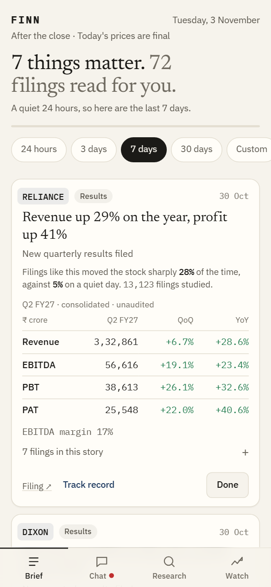
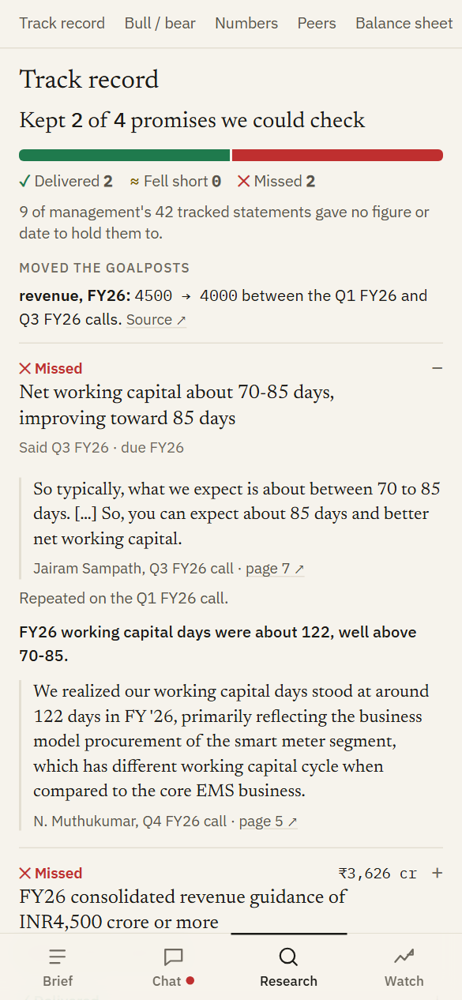
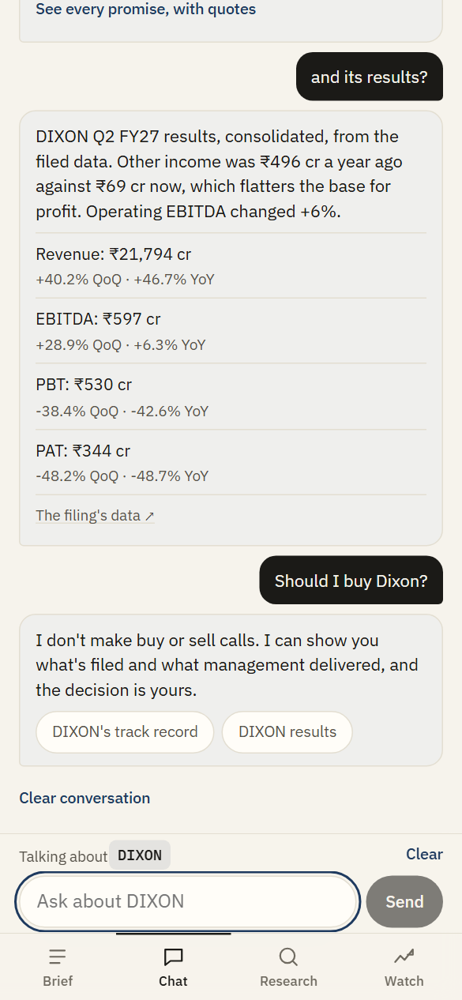
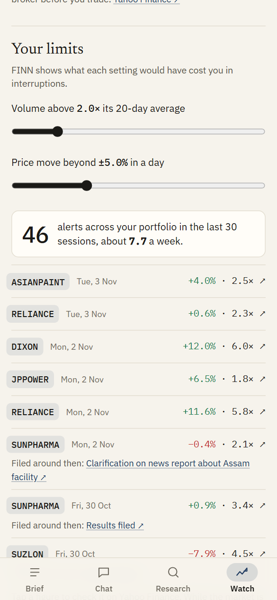

# FINN

**Reads every filing across a portfolio, shows the few that matter, and keeps score of what management promised.**

A mobile-first financial investment agent for Indian equities, built for the ENAM Holdings AI Engineer Build Challenge.

### Try it on a phone: [https://finn-aehf.onrender.com/](https://finn-aehf.onrender.com/)

It runs on a free host, so the first open can take about a minute. No login or setup is needed. Filings and prices ship with the app up to 3 Nov 2026.

<table>
  <tr>
    <td></td>
    <td></td>
    <td></td>
    <td></td>
  </tr>
  <tr>
    <td align="center">Brief</td><td align="center">Research</td><td align="center">Chat</td><td align="center">Watch</td>
  </tr>
</table>

## Two minutes with it

1. **Brief:** the filings that matter across an 18-company mock portfolio, for the last 24 hours or any dates you pick. Tick them off until it says "That's everything." The rest is collapsed, with a count of what was buried.
2. **Research:** open `KAYNES`. FY26 revenue was guided at ₹4,500 crore plus and came in at ₹3,626 crore, with the quote, page and filing one tap away. Then enter any NSE ticker: its filed numbers appear first, and its track record fills in over several minutes.
3. **Chat:** try "What matters today?", then "Dixon's track record", then "and its results?". It remembers the company. It refuses "Should I buy Dixon?". It will also just say hi back.
4. **Watch:** move the volume and price limits and see how many alerts each setting would have sent over the last 30 sessions. Edit the holdings, and the Brief, alerts and chat follow your list.

## The point of view

**The product is a record of whether management keeps its word.** Summarising a call is a commodity. Checking last year's promise against this quarter's filing is what an analyst does. Push and pull share that idea: research extracts what management committed to, and when a new result lands, the Brief checks it against what was promised for that quarter.

**A brief that ends.** An investor doesn't need another feed. The Brief counts down and stops, so its silence can be trusted.

**You see what a limit costs.** Nobody can judge "2× volume" in the abstract, but anyone can judge "7 interruptions a week".

**Chat is a section, not the interface.** Open-ended chat is where invented answers live, so the Brief stays the front door, and code writes chat's answers about companies from FINN's records.

## Why you can check it

- Models return sentence numbers rather than text, so every quote on screen is verbatim.
- Results figures and financial verdicts are calculated by code from the XBRL the company filed. A model never does the arithmetic.
- A figure that isn't in its cited sentence gets dropped.
- The company's name is hidden from the analysis models, which enforces the primary-sources rule instead of just requesting it.
- "Can't verify" and "Too vague to test" are real answers, and the app shows them.

| What was measured | Result |
|---|---|
| Filing ranks, learned from one year and tested on 72,721 later filings | Top-tier filings moved stocks sharply 4.98× as often as a quiet day (results do much of that: 1.68× without them) |
| Results figures against screener.in, 18 holdings | 459 of 486 within 1.5%. Most of the 27 differences are lines screener defines differently, and 2 are unexplained |
| Quotes against their source PDFs | 1,067 of 1,067 verbatim |
| Model-written lines against their sources | 0 of 1,925 failed, after one wrong page number was corrected |
| Random tickers with no model, 200 runs | No crashes |

These reviews were run by Claude, the AI used to build FINN, and no person has audited them. [`finn/docs/RESULTS.md`](finn/docs/RESULTS.md) gives every number with its limits, including the first runs that failed and what they changed.

## Models and cost

| Step | Model |
|---|---|
| Sorting obvious paperwork, about half of all filings | None (rules) |
| Results figures, live limits, calendar, follow-ups, one-page summary | None (code) |
| Reading filing PDFs and extracting promises | Shipped: Claude Haiku. New: gpt-oss-20b on Groq |
| Judging promises and writing bull and bear | Shipped: Claude Sonnet. New: gpt-oss-120b on Groq |
| Chat | Qwen 3.8 on Groq |

Building everything, including rework and experiments, cost about **$10.60** in model calls. **Running it costs $0**: new work needs only a free Groq key. Requests are split and paced to the free limits, chat keeps its own model so research can't starve it, and answers are cached so repeating work costs nothing.

## What to know before relying on it

- **Free-model research is weaker.** The 23 ready-made reports were built with Claude. A company you add is read by a free model, finds less, and says so on its page. An early audit found 3 of 8 Dixon verdicts clearly wrong, so stricter code checks were added, and those checks haven't had a clean test on unseen companies. It manages about 3 to 10 new companies a day.
- **Verdicts are few.** Across the shipped reports, 40 statements are settled and most stay "can't verify", "too vague" or "not due yet".
- **Nothing reaches a closed app by default.** Alerts land in the app. Browser notifications are built and need keys to turn on, and they haven't been tried on a real phone.
- **The free host forgets.** It sleeps when idle and wakes with the shipped snapshot, so companies added since are lost, though the app reminds it of your own list.
- **No real investor has used it yet.** It reports what filings say, can be wrong, and isn't investment advice.

Left out on purpose: portfolio P&L, logins, news and broker content, and analysis of investor decks, because FINN tests management against filed numbers rather than its own framing. [`finn/docs/DECISIONS.md`](finn/docs/DECISIONS.md) explains these choices, including the ones real data overturned.

## In this repo

```
finn/finn/     Python: filings, XBRL, prices, ranking, promise tracking, models, chat, API
finn/web/      React PWA: Brief, Chat, Research, Watch, one-page Summary
finn/eval/     how each accuracy claim was measured, and can be rerun
finn/tests/    unit, API and browser tests
finn/data/     finn.db, the snapshot the app ships with
```

To run it yourself, see [`finn/README.md`](finn/README.md). It needs no keys to open, because the database ships with real data.
